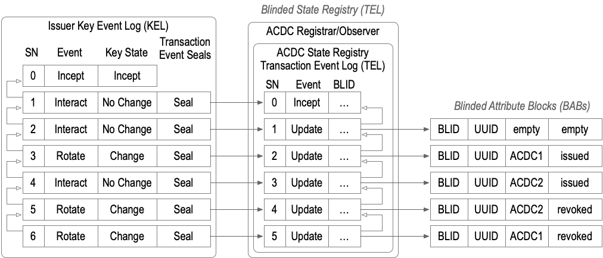
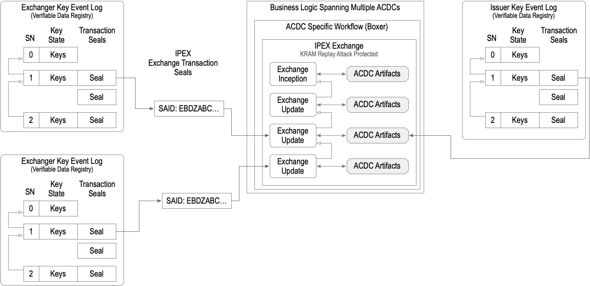
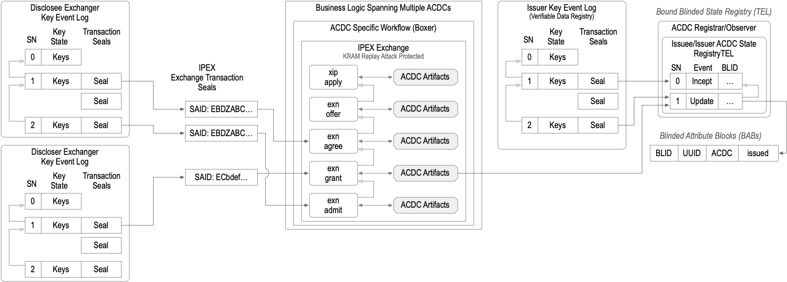
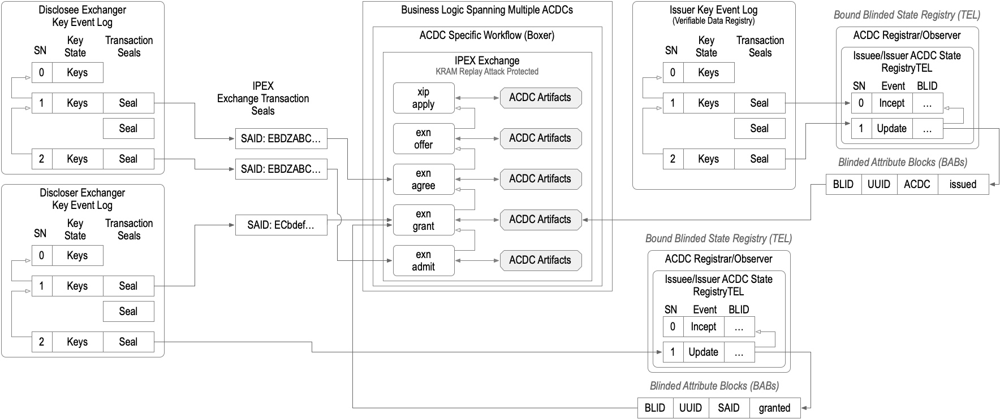

# ACDC IPEX Negotiation

There are several mechanisms that could be used to negotiate a graduate disclosure. These include: attribute path lists, aggregate block label lists, metadata ACDCs, Schema, and Decompositions of Schema.   

The problem with negotiating with schema docompositions is that attributes appear disjoint in a schema so pathing to indicate an attribute gets complicated quickly and the pathing logic has to understand JSON schema syntax at a deep level.  Whereas in a metadata ACDC the attribute paths are not disjoint so indicating an attribute at any nesting level can be handled with a path string.   

So it feels like to me that negotiation should be using Composed Schema as type. So only the SAID of the schema is provided and assume the full schema is cached or attached. Then use pathing of attributes to request the level of partial disclsure and metadata ACDCs for terms negotiation prior to disclosure.

Desired attributes are requested as a list of paths of each attribute or block. If the path is a block then the whole block is meant to be disclosed. If the path is a field in a block only the fields in that block at that field level needs to be disclosed. Any fields whose value is a nested block in that block does not need to be expanded and disclosed.  

With nested partial disclosure in an ATT section in order to disclose any field in a block all the simple fields in that block must also be disclosed but non-simple fields i.e. fields whose value is a nested block need only disclose the SAID of the block. So specifiying any simple field via a path would get you all the simple fields in the block holding the specified leaf of the path.

Whereas specifying a block (directory) would be short hand for disclosing the full tree attached all the way down.

For ATT section ACDCs the pathing gets simple since its an array and only the unique field label needs to be specified to designate a given block.

For example
```
'a':
{
    'd': "Ebslde",
    'u': "Abldle"
    'i': "EDdecd",
    "grades":
    {
         "d": "Efghi",
         "u":  "Abdefs",    
         "gpa":  3.7,
        "transcript":
        {
             "d": "EBDE",
             "u":  "ACEF",    
               "math": 3.5,
              "english":3.8",
        }
     }
}
```

}

SAID of composed schema as type defines the ACDC in the apple: EABCDSS...
Attribute path list defines what attributes are being asked for: ['a/i', 'a/grades/']
So apply is asking for the top level of the "a" section via 'a/i'   or '/a/i' and for the full grades block and any nested subblocks of grades via 'a/grades/' or '/a/grades'
Or because grades is nested down from the top level of 'a'.  A path list of simply ["/a/grades/"

Where as a path list of  merely ['/a/grades/'] subsumes the other path list.

To get gpa (and the issuee aid) without the grades detail  would be  simply ['/a/grades/gpa']


In response to an offer, the chain to the apply could either reply with the same schema and path list, or the rule could be that an offer chained to the same apply that leaves the path list None implies it is offering the same path list.
and then the offer includes a metadata acdc that exposes the rule section and the att section said but not the pathed attributes.
The agree then chains to the offer which indicates agreement
The grant then provides an uncompacted version of the ACDC with the appropriate level of disclosure.


To generalize this to apply to those who want graduated disclosure of multiple ACDCs in a chain, I suggest a dict
where the item label is the SAID of the ACDC in the chain, and the value of the item is the path list of disclosed attributes.

The path list is not limited to attribute and aggregate sections; paths could include edge and rule section paths.

For example, two chained acdcs one with an attribute section and one with an aggregate section

{
"EABCDED": ["/a/gpa"],
"EBQRSTR" : ["/A/i","/A/photo"]
}

The path dict requests the gpa field in the ACDC with schema "EABCDED" which means that anything on the path to the "gpa" field must also be disclosed and also requests the selectively disclosable Issuee and photo blocks of the schema "EBQRSTR"


We cannot use ACDC SAIDs in an application in general because the actual ACDC SAID is assumed not to be known by the applicant. But for defined ACDCs, as would be the case for any ACDCs governed by an EGF, the  SAIDS of the ACDC schemas would be known. And so the request is for an unidentified ACDC but with a given schema SAID and the paths indicated by the path list.

When the ACDC disclosure includes a bespoke ACDC the ap
When the ACDC disclosure includes a bespoke ACDC, the applicant won't necessarily know the SAID of its schema in the application, but the initial offer can provide it via a bespoke metadata ACDC, and subsequent apply messages can negotiate on that bespoke ACDC schema SAID.


The paths shown use the "/' delimeter but for CESR compatibility we could use the CESR Pathing BASE64 compatible path delimeter "-".     Or if we  do a little work to name the path list  field normatively we could have the tooling auto convert from "/" delimited paths to more compact "-" delimited paths when using CESR serialization of the exchange message.
 Or we allow either delimeter and just inject and extract the path as a tuple for reasoning so we are delimiter independent at the reasoning level..
 
###  Pather for pathing

I agree that using the existing Pather makes the most sense. This does impose some subtle constraints on the serialization. Currently, pather is used in attachments to reason about the message to which the path is attached. The pathed material group code in the attachment tells the parser to interpret the encoded string as a path.

For generic exchange messages, field values that are strings do not know how to use pather serialization unless we make them special fields. So where we convert to a Pather is relevant. There are some choices and so more discussion before hardening is warranted.

Another related option not mentioned so far is which block in an exchange should request disclosure paths in an Apply go in. There is a query block and an attribute block. By design, there are two blocks so that the exchange (as well as the other message types, query and reply) can more easily model ReST endpoint logic to minimize the impedance mismatch for building KERI APIs. 

If one thinks of an http verb with a URL with path and query string and verb message body, the modeling is as follows. The route field in the exchange holds the path from the URL. The query block holds the query string as a field map, and the attribute block holds the verb message body.

So we can put disclosure request information in the apply in three places, the route, the query block, and the attribute block

The route prefix is /apply, but one could overload that and use /apply/schemasaid.
One could define a field in the query block to put a dictionary of paths
One could define a field in the apply block to put a dictionary of paths.

Because the vLEI did not employ graduated disclosure, there was no need to go to any lengths to define this stuff, but now we are discussing the syntax for negotiating over graduated disclosure and its worthwhile now  to expose these subtleties

### Reasoning with graphs vs reasoning with schema

The multi-ACDC dict is keyed by schema SAID ({"EABCDED": [...], "EBQRSTR": [...]}). That can't disambiguate a chain that contains two credentials of the same schema — two same-type creds collapse to one key. Since you already note the applicant can't know the actual ACDC SAIDs, keying by the edge/node label in the requester's own apply-schema (which the applicant does control) might be the more robust handle for chained disclosure.
You are right the simple example does not account for a chain with repeated schema. So we need to be more thoughtful in how we define it.

This opens up a bigger question, and your reference to the “apply-schema” itself brings in a related issue. This is an area where I have spent some significant effort. The W3C community wants to reason using knowledge graphs. A schema is a type of knowledge graph. A chained graph of ACDCs is also a type of knowledge graph. ACDCs can be modeled with labeled property graphs, which are also a type of knowledge graph.

The core insight for me is not whether we have the ability to reason about or with knowledge graphs, but what type of reasoning we are doing, and whether we should constrain the type of reasoning in a layering of concerns so as to better address the concerns at each layer. Knowledge graphs, as widely used in that community, do not, have as first-order design properties, any security, authenticity, verifiability, confidentiality, or privacy properties as layered concerns. They only model semantics, meaning. These non-semantic concepts are rarely employed, and when they are, they are bolt-ons to the standard knowledge graph.  I found the W3C approach of attempting to bolt on security to RDF graph expansions a pathological mess (excuse my strong language). What knowledge graphs are meant to do is reason about the semantics of what is in the graph, not reason about authenticity or correlatability as a precursor to what goes in a graph in the first place. These are different types of reasoning.

One of the prime motivations for ACDCs was to invert that layering. To build mechanisms for security, confidentiality, and correlation resistance in layers that are employed before the semantic reasoning happens.

So disclosure is reasoning about exposure. What parts to expose when. Not what those parts mean once they are exposed. So, to better separate concerns along a layering approach, my intuition is we should minimize the role the schema plays in this layer of reasoning, that is the what to expose layer. This is accomplished by using schema as type, i.e., the SAID of the schema, and the schema validation validates the type. This contraindicates using bespoke schema as the way to indicate exposure. And using schema to indicate exposure is more complicated because pathing in schema is disjoint and requires deep knowledge of the schema semantics to reason about exposure paths.

Reasoning about exposure of elements of a graph when those graph elements are expandable or  collapsable or compactifiable is reasoning about the graph structure not the semantics of the information contained in the graph structure. In this case, graduated disclosure, it seems to me we can reason about graph structure using a simplified expression of the graph, not the most complex expression of the graph (JSON Schema). So we should think about what the minimally sufficient means are for reasoning about graph structure not the most expressive means (JSON schema) for that graph structure we have available.

So if we think of an ordered dictionary as a graph, we can model a graph of ACDCs with a dictionary (associative array or field map; we already model the guts of each acdc with a dictionary), so we can extend that by modeling the full graph of ACDCs with an expanded dictionary. This allows us to use a pathing language that is as simple as we can make it. A path is a tuple of labels which can be compactly serialized to a string with a path delimiter.

It has to include a way to path along a chain of ACDCs not merely into an ACDC. As you point out, with the overly simple example I provided of a path list. But we could use an ordered path list to represent a branch in an ACDC chain (only one possible branch) or include the full edge labeling path from the leaf ACDC back up the tree when not a simple chain (one branch). We can have relative to ACDC paths and absolute paths that are paths through the aCDC graph.

The edge labels in the path enable one to explicitly trace which edge leads to which ACDC schema SAID and then path down into that ACDC to the disclosed leaf.

The insight is correct: a request to disclose that uses a path to a leaf implies a closure of all that must be disclosed in order to disclose the leaf, but no more. So compacted sibling branches stay compacted. But then we need a compact way of requesting full expansion, so I used the trailing “/“ to indicate that. This provides a compact way of saying expand all branches below this node.

A path to a leaf implies that the nodes along that path must be diclosed but not sibling branches and no branches below the node holding the leaf, but all leaves in the same node.  This is unambiguously implied by a leaf path.

Whereas a node path (trailing "/") already indicates more than a leaf. So we can let that indicate an expansion of the node and all children nodes but no sibling branches. I think this is reasonable. If we need siblinge branches then we specify a path to the sibling leaf or node.  The node path rule means if I want the whole graph then I specify a node path to the root node of the tree. If I want a subgraph then the node path to the top node of the sub graph.  If I only want specific leaves and this implies the nodes to get to the leaf then I use a leaf path. The leaf path is a scalpel the node path is a hammer.

 
 ## Clarifications
 
### Issuee AID for aggregative (selectively disclosable) ACDCs

I believe for the core SEDI identity credential, the appropriate choice is to use the selectively disclosable Aggregate section.  The state of Utah has not decided, but my suggestion is that it be selectively disclosable, given that most use cases seem to fit that model.  In many cases, the only disclosed field value would be the issuee AID field.

The "i" field for Issuee is optional. When not present, it means the ACDC is issued to whom it may concern (untargeted).

The operator I2I is intended to work for either att or agg ACDCs when an "i" field is present.

In the case where no "i" issuee aid field is provided, the I2I operator on an edge would fail. 

This is a case where the term "holder" is confusing, because anyone could "hold" and present an untargeted ACDC. Unlike W3C credentials, where the "holder" binding is variable, with both weak and strong forms. An ACDC either has a cryptographically verifiable binding (i.e. strongest) via an "i" field with the issuee aid or there is no cryptographically verifiable binding. It's a boolean concept.

To elaborate:
An attributive ACDC has an "a" section, and if its "a" section has an "i" field at its top level, then the value of that "i" field is the issuee AID.
An aggregative ACDC has an "A" section, and if the second block in its "A" section has an "i" field, then the value of the "i" field is the issuee AID.
An ACDC can only be either attributive or aggregative, not both (mutually exclusive)

The spec should be clarified to precisely describe where the 'i' field in an Agg section is found when present.  
The issuee in an ACDC with Agg section (selectively disclosable) is the "i" field in the second (index 1) attribute block. 

The SerderACDC class has two relevant properties that provide the issuer AID as appropriate for the type of ACDC (attributive or aggregative). The properties are the .iseaid and .issuee.  The .iseaid property returns the issuee aid or None (when the AID is untargeted). The .issuee property returns a Prefixer Matter primitive instance whose .qb64 property is the issuee aid or None.  For example, see these asserts in the test_selective_disclosure_aggregate_JSON()

```
    assert acdc.iseaid == BOB
    assert acdc.issuee.qb64 == BOB
```


### Presentation Registries
However, there is some discussion about how to manage presentation registries. Should they be optional on a citizen by citizen basis. Or even a bulk issuance set member basis.  A presentation registry enables the Issuee to detect impersonation fraud of a compromise of its signing keys, so high stakes presentations want to to use a presentation registry, which requires that the "rd" field be populated at the time of issuance to force the verifier to verify the presentation against the presentation registry controlled by the issuee.    

This leads me to believe that we need to find a high-stakes use case where the Issuee would want to enforce a presentation registry. Maybe a drug prescription presentation where the prescription is either an ACDC or the cargo of a bespoke ACDC.


## Diagrams
### Blinded State Registry


### Anchored IPEX Exchange Transaction Simple


### Detailed Anchored IPEX Exchange Transaction


### Detailed Anchored IPEX Exchange Transaction with Presentation Registry



### Example SEDI

So a little asynchrony here in thought. I have not digested your latest set of lengthy commentary. But I wanted to capture my second thoughts on this question first.

After more thought, I think my answer to the SEDI iidentity credential as an aggregate credential (array of attributes instead of nested field map). I realized I was falling into the trap of letting prior usage dictate instead of first principles.

So I now think that the SEDI core identity core identity credential should be an attribute credentials. Let me explain why.

From a data correlation perspective (the first principle). The one feature that an aggrative credential provides over a attributative credential is that the attribute blocks at the top level are not labeled with meaningful labels. So the position of a block within the array can be managed so as not to leak information where such information could be leaked via relative position. In the case of the core SEDI identity credential, there are no fields that benefit from such arrangment. The field labels will be well known and all the fields are a defined set so there is no “advantage” to using the aggrative form and there is a definite disadvantage to using the aggrative form. The disadvantage is that reasoning about the fields to be disclosed now does not use fully labeled paths but either must a derived path. If one says that the array index is in the path, then one defeats the one property of the array that one wanted to preserve. That means pathing for apply messages means that under the hood one has to convert an abstraction to a path without being given the index. One has to create a reverse lookup table that maps the unique label embedded in each attribute block into an index so that a path can look up the array index.

While this is no terribly complex, since there is no advantage to using an array for this credential, more complexity for the most used credential, the core SEDI identity credential feels like a poor decision.

So, given you have already done an example with an aggregation. I think it’s useful example still. But it would be great to do another example one where the core SEDI credential was instead an attributive one, each attribute besides the issuer aid, gets a nested labeled partially disclosable block with a said and uuid in its block.

This brings up the question of what is a valid use case for the aggrative credential that benefits from not labeling the attribute blocks where relative position in the array could leak information. The use case that I can think of is an array of Boolean flags for age thresholds. Each age threshold has an element so that the number of elements does not leak anything about which age thresholds are present. All are present but each is true or false.

And to go further, one could add empty elements in the array and randomize the relative positions in the array of the age thresholds so that a disclosure of given array of age threshold does not leak information about which elements in the array correspond to which ages. But the later one is probably overkill.

An aggrative array in this case is a poor mans sparse merkle tree.

So in hindsight I got the answer backwards. A better example would be to use an attributive ACDC for the core SEDI identity credential and use an aggrative credential for the proof of age credential only includes several Boolean flags for a set of ages like 13, 16, 18, 21. For the most important minimum legal ages

The plan is to eventually use a sparse merkle tree for this but using the Boolean array replicates how mdoc does so its at least as good as mdoc

Anyway appreciate your feedback thoughts as too the inversion of the example.